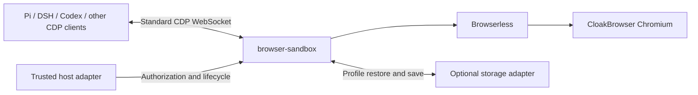

<p align="center">
  
</p>

# browser-sandbox

**One browser runtime. Any harness.**

A shared browser runtime for AI agents, built on **Browserless + CloakBrowser Chromium**. The goal is to let Pi, DSH, Codex, and other CDP-compatible clients share reliable browser infrastructure while keeping their own tools and workflows.

> **Status: development preview.** The standalone TypeScript runtime, lifecycle tests, host client, and container build are now present. This is not a published package or production release. See [usage](./docs/usage.md), and [issue #1](https://github.com/TGYD-helige/browser-sandbox/issues/1) for the contract and remaining acceptance work.

## Why

Agent harnesses need many of the same browser capabilities: isolated connections, reusable login state, predictable cleanup, and time to complete a human login. Reimplementing these in each harness creates duplicate lifecycle logic and inconsistent behavior.

browser-sandbox brings that behavior into one runtime. Harnesses connect through standard Chrome DevTools Protocol (CDP); host adapters provide authorization and deployment integration. The core stays independent of model tool loops and platform business models.

## Architecture



| Layer | Responsibility |
|---|---|
| **Browserless** | Browser startup, concurrency, queueing, and total session timeouts |
| **CloakBrowser** | Chromium binary and browser fingerprint defaults |
| **browser-sandbox** | Execution-scoped access, Profile lifecycle, cancellation, reliable cleanup, and optional integrations |
| **Host adapter** | Identity authorization, Profile mapping, execution isolation, deployment, and storage capabilities |
| **Harness** | Browser tools, model interaction, and client-side session handling |

## Runtime capabilities

| Area | Behavior |
|---|---|
| **Standard CDP** | A separate authorized WebSocket endpoint for each execution |
| **Lazy startup** | Start Chrome and prepare Profile data on first connection; unused browsers skip storage work |
| **Resource control** | Bounded concurrency and queues, cancellation, timeouts, and idle reclamation |
| **Profile reuse** | Temporary Profiles by default; optional stable profileId for persistent login state |
| **Reliable shutdown** | Confirm process exit before Profile reuse; preserve recoverable data when saving fails |
| **Persistent site data** | Native Profile data and persistent Cookie checkpoints, including deletion and expiry semantics |
| **Optional remote storage** | Restore and save through a host-provided adapter without a platform SDK dependency |
| **Live sessions** | Query, retain, renew, release, or stop the current browser; keep original pages across client disconnects within the hard timeout |
| **Human takeover** | Coordinate automation and human control with leases and stale-frame protection |
| **Files and rendering** | Execution-scoped upload/download handling, screenshots, and Chinese/Emoji font support |
| **Chrome extensions** | Load trusted unpacked extensions from a read-only mounted directory on each browser launch |

## Local Chrome extensions

Add the following settings to your existing sandboxed Compose service:

```yaml
environment:
  BROWSER_EXTENSIONS_DIR: /browser-extensions
volumes:
  - ./extensions:/browser-extensions:ro
```

Place each unpacked extension in its own subdirectory, for example `./extensions/my-extension/manifest.json`. Make directories traversable and files readable by the browser's execution UIDs. Adding or removing extension directories takes effect on the next browser launch; running browsers keep their loaded extensions. Use trusted extensions only: they load into every execution browser and may access page and login data according to their permissions.

See [extension setup and limitations](./docs/usage.md#load-local-chrome-extensions) for Docker flags, permissions, and verification. Use an image built from a revision that includes this feature.

## Live viewer and remote access

Enable the optional access listener to watch the same browser from a local webpage or a remote HTTPS/WSS endpoint. The bundled browser-viewer Web Component supports page selection and confirmed human takeover with basic input. Local, Docker, Kubernetes, and Worker-fronted origins use the same execution contract; the browser remains on the supported Linux runtime. See [live viewing and deployment](./docs/live-view.md) for authorization, setup, embedding, and limitations.

The optional [browser-sandbox-auth skill](./skills/browser-sandbox-auth/SKILL.md) teaches agents to request secure sign-in through their existing code execution tool, without registering another model tool. This checkout exposes it through .agents/skills; other harnesses can install the skill directory using their own skill discovery mechanism. The package includes skills/browser-sandbox-auth. The host must still provide the browser endpoint, viewer, and automation coordination described in the live-view guide.

## Profiles

Execution identity and persistent browser identity are separate. The host authorizes access; knowing a profileId does not grant access to its data.

| Configuration | During use | At execution end |
|---|---|---|
| No profileId | Create a temporary Profile | Close and remove temporary data |
| profileId, no remote storage | Reuse a local persistent Profile | Close gracefully and retain the Profile |
| profileId with remote storage | Restore the latest confirmed archive on demand | Save and confirm before releasing the execution copy |

Only one execution may use a Profile at a time. Persistent data survives execution cleanup according to its storage configuration. Live page retention and cold Profile restoration are different: restoring site data does not restore an in-memory page or its JavaScript state.

## Design principles

- **Generic by default.** Express differences through data and adapters. Keep harness-, customer-, and workflow-specific branches out of the shared core.
- **Small interfaces, clear ownership.** Keep browser lifecycle state inside the runtime and expose accurate outcomes to the host.
- **Reuse before adding.** Build on Browserless and existing platform facilities; keep the implementation concise and readable.
- **Pay for work when used.** Defer browser startup and storage work until needed; keep slow transfers off unrelated control paths.
- **Preserve safety and data.** Keep sandboxing, authorization, cancellation, exclusive Profile access, and recoverable failure handling intact.

## Verification

Run `pnpm install --frozen-lockfile`, `pnpm typecheck`, `pnpm lint`, and `pnpm test` locally. Linux isolation checks require the supported Linux environment; use `pnpm test:linux` when running from another operating system.

The **Functional and performance gates** workflow runs on pull requests and master pushes. It checks native AMD64/ARM64 images, extensions, live viewing and authentication, Pi session handoff, and unused-browser overhead. Its final **Functional and performance gate** check succeeds only when all four prerequisite jobs succeed; configure this check as required in branch protection to enforce it at merge time. The separate **Browser integration** workflow retains the harness and model-driven browser tests.

Performance runs use 20 measured samples after three warmups per workload, comparing the same measurement client against the base and proposed runtimes on the same runner. Duration budgets are baseline P95 × 1.25 + 25 ms. Raw samples and comparisons are uploaded as workflow artifacts, including on comparison failure.

| Workload | Measurements and checks |
|---|---|
| Unused, temporary, local persistent, and remote Profiles | Registration, Profile acquisition/restoration, browser launch, first rendered screenshot, finalization, and archive transfer. Local Profiles alternate execution UIDs; the larger fixture includes 100 persistent Cookies, IndexedDB, and 1,000 synthetic small files. |
| Four clients competing for two browser slots | Slowest-client readiness/finalization, batch duration, throughput, and retained cgroup memory. |
| CDP traffic | Small commands, four simultaneous connections, 1 MiB responses, and noisy screenshots larger than 1 MiB; fixed-work batch durations and throughput. |
| Slow archive restore/upload | A controlled first-chunk barrier holds the transfer until an unrelated execution registers, renders, and finalizes. That work must complete before the transfer is released. |
| Queue cancellation | Cancel and finalize a third starting client behind two live browsers, reject its revoked grant, then release a slot and measure successor readiness. |
| Files | Streamed 16 MiB transfers, four concurrent 4 MiB transfers, digest verification, slow readers, and cancelled uploads. Fill all sixteen transfer slots, confirm admission rejection, measure CDP responsiveness, then cancel and verify capacity recovery. |
| Viewer | Zero, one, or four authenticated viewer WebSockets against an animated page; first frame, frame intervals, CDP latency, CPU, memory, runtime file descriptors, process count, frame rate, and wire traffic. |
| Repeated lifecycles | Real navigation/screenshots and finalization, with execution directory removal checked after every cycle and resource growth checked across batches. |

Resource maxima have separate initial regression budgets: memory uses baseline × 1.25 + 64 MiB, normalized CPU usage uses baseline × 1.25 + 50,000 microseconds per second, viewer traffic uses baseline × 1.25 + 64 KiB per second, runtime file descriptors allow four additional descriptors, and process count allows two additional processes. Temporary disk usage allows baseline × 1.25 + 64 KiB. Repeated-lifecycle runs additionally reject growth beyond 128 MiB of memory, four runtime descriptors, two processes, or 64 KiB of temporary data between the median first and last five batches, even if the baseline also grows.

For manual quality runs, select `baseline_ref` and optionally disable the Pi model-driven session test with `run_model`. The baseline must support preparation timing diagnostics and the access listener; missing required measurements fail the run. Model-driven steps need the configured OpenAI-compatible endpoint, model, and API-key settings and are skipped for fork pull requests.

The separate **Browser performance soak** workflow runs on manual dispatch or on pull requests carrying the `performance-soak` label and defaults to 500 measured lifecycles per image, plus warmup cycles, on both architectures. Its `cycles` input accepts multiples of 20 from 100 to 2,000. The ordinary PR workflow includes a shorter 20-cycle run. The long workflow is not a required PR check.

These controlled fixtures are regression guards, not production SLAs or proof that all leaks are absent. Profile payload sizes describe injected data rather than total archive size. Viewer timings measure authenticated frame delivery, excluding client image decoding and screen paint. Storage uses a local controlled HTTP server; network/cloud latency and real-site variability require workload-specific measurements.

## References

- [Browserless](https://github.com/browserless/browserless) — upstream browser infrastructure used for startup, concurrency, queueing, and session timeouts.
- [CloakBrowser](https://github.com/CloakHQ/CloakBrowser) — upstream project providing the Chromium integration and fingerprint defaults.

## License

The code in this repository is licensed under [MIT](./LICENSE). Browserless, CloakBrowser, and their browser binaries remain subject to their respective licenses. This repository's license does not grant rights to redistribute upstream binaries or operate an upstream-based hosted offering; verify the applicable terms for your distribution and deployment.
