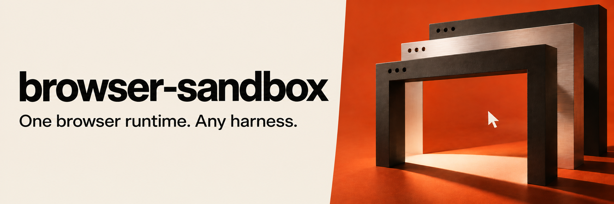
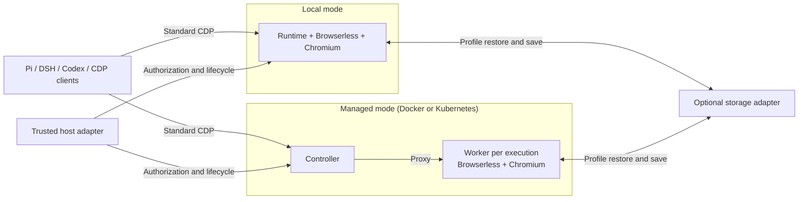

<p align="center">
  
</p>

# browser-sandbox

**One browser runtime. Any harness.**

A shared browser runtime for AI agents, built on **Browserless + CloakBrowser Chromium**. Pi, DSH, Codex, and any other CDP client get isolated browsers, reusable login state, and reliable cleanup through standard Chrome DevTools Protocol, without reimplementing browser lifecycle in each harness.

> **Status: preview.** The latest release is [v0.2.0](https://github.com/TGYD-helige/browser-sandbox/releases/tag/v0.2.0), a multi-architecture (amd64, arm64) image. Managed Docker and Kubernetes modes are internal-only previews. See [issue #1](https://github.com/TGYD-helige/browser-sandbox/issues/1) for the contract and remaining acceptance work.

## Quick start

```sh
pnpm install --frozen-lockfile
pnpm docker:build
bash .github/scripts/verify-image.sh browser-sandbox:local
```

The verification script runs the image in temporary containers with the required security options. Then [register an execution and connect a CDP client](./docs/usage.md).

## Architecture



| Layer | Responsibility |
|---|---|
| **Browserless** | Browser startup, concurrency, queueing, and total session timeouts |
| **CloakBrowser** | Chromium binary and browser fingerprint defaults |
| **browser-sandbox** | Execution-scoped access, Profile lifecycle, cancellation, and reliable cleanup |
| **Host adapter** | Identity authorization, Profile mapping, deployment, and storage |
| **Harness** | Browser tools, model interaction, and client-side sessions |

## Deployment modes

| Mode | Browsers | Persistent Profiles | Controller replicas | Guide |
|---|---|---|---|---|
| **Local** (default) | One container, one UID per execution | Local directory or host remote storage | — | [Usage](./docs/usage.md) |
| **Docker** | One private worker container per execution | Host remote storage or controller volume | 1 | [Managed Docker](./docs/managed-docker.md) |
| **Kubernetes** | One worker Pod per execution, Helm chart | Host remote storage or controller PVC | 1, or active-active with host remote storage | [Kubernetes](./docs/kubernetes.md) |

Managed modes share one image: the controller is the only agent-facing endpoint and proxies all traffic to workers. See [Profile storage](./docs/profile-store.md) and [controller recovery](./docs/controller-recovery.md) for persistence, restart, and capacity behavior.

## Capabilities

| Area | Behavior |
|---|---|
| **Standard CDP** | A separate authorized WebSocket endpoint per execution |
| **Lazy startup** | Chrome and Profile data are prepared on first connection; unused browsers skip storage work |
| **Resource control** | Bounded concurrency and queues, cancellation, timeouts, and idle reclamation |
| **Profiles** | Temporary by default; a stable profileId keeps login state, with one execution per Profile at a time |
| **Reliable shutdown** | Process exit is confirmed before Profile reuse; recoverable data is kept when saving fails |
| **Live sessions** | Query, retain, renew, release, or stop a browser; pages survive client disconnects until the hard timeout |
| **Live viewer and takeover** | A [browser-viewer Web Component](./docs/live-view.md) with page selection and confirmed human takeover |
| **Sign-in skill** | The [browser-sandbox-auth skill](./skills/browser-sandbox-auth/SKILL.md) lets agents request secure sign-in through their code execution tool |
| **Files and rendering** | Execution-scoped uploads and downloads, screenshots, and Chinese/Emoji fonts |
| **Chrome extensions** | Trusted unpacked extensions from a [read-only mounted directory](./docs/usage.md#load-local-chrome-extensions) |

## Profiles

Execution identity and browser identity are separate: the host authorizes access, and knowing a profileId grants nothing.

| Configuration | During use | At execution end |
|---|---|---|
| No profileId | Temporary Profile | Close and remove its data |
| profileId, no remote storage | Reuse a local persistent Profile | Close gracefully and keep it |
| profileId with remote storage | Restore the latest confirmed archive on demand | Save and confirm before releasing the local copy |

Restoring a Profile restores site data such as persistent Cookies, not live pages or JavaScript state.

## Design principles

- **Generic by default.** Express differences through data and adapters, not harness- or customer-specific branches.
- **Small interfaces, clear ownership.** Lifecycle state stays in the runtime; the host gets accurate outcomes.
- **Pay for work when used.** Defer browser startup and storage work until needed.
- **Preserve safety and data.** Keep sandboxing, authorization, exclusive Profile access, and recoverable failure handling intact.

## Development

Run `pnpm typecheck`, `pnpm lint`, and `pnpm test`. Linux isolation checks require a supported Linux environment; use `pnpm test:linux` from other operating systems. CI functional and performance gates are described in [.github/PERFORMANCE.md](./.github/PERFORMANCE.md).

## License

The code in this repository is licensed under [MIT](./LICENSE). [Browserless](https://github.com/browserless/browserless), [CloakBrowser](https://github.com/CloakHQ/CloakBrowser), and their browser binaries remain subject to their own licenses. This license does not grant rights to redistribute upstream binaries or operate an upstream-based hosted offering; verify the applicable terms for your distribution and deployment.
